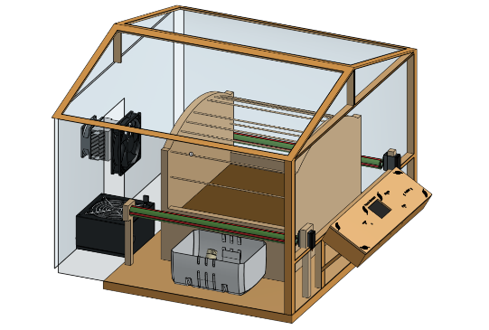

# Prototype design

## Editable CAD and circuit files

- [Greenhouse STEP model](3D%20design/3D.step)
- [Production STEP model and Onshape document link](Production/3D%20design/)
- [KiCad PCB project, schematics, footprints, and PCB STEP models](PCB/)
- [PCB fabrication outputs](Production/PCB/)

These files were imported unchanged from [Nadoooor/Eruca-Sync](https://github.com/Nadoooor/Eruca-Sync/tree/49f52b0db70bf52fc38d7b9a41fe47a303049562). See [IMPORT-NOTES.md](IMPORT-NOTES.md) for credits and license details.

## Portfolio illustrations

These illustrations were extracted without alteration from the supplied research portfolio.

