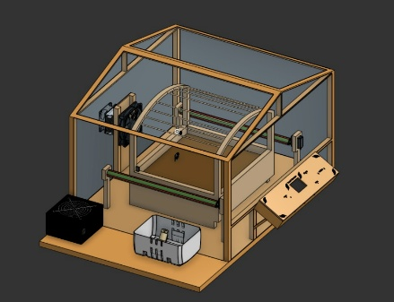

# Eruca Sync Smart Greenhouse

An automated greenhouse prototype that uses environmental sensing and feedback control to protect crops from changing growing conditions.

**STEM capstone | Team 10206 | 2025-2026 Second semester**

## Egypt grand challenges

Reducing the effects of climate change on agriculture and improving the use of arid areas.

## Prototype

An ESP32-S3 monitors temperature, soil moisture, and light intensity and controls actuators to maintain suitable growing conditions.

## Project materials

| Material | File |
| --- | --- |
| Portfolio | [Research portfolio](portfolio.docx) |
| Poster | [Full-size poster](poster-fullsize.pdf) |
| Prototype design | [Design illustrations and editable models](DESIGN.md) |
| Firmware | [Source and build instructions](Firmware/README.md) |
| Editable 3D model | [Greenhouse STEP model](3D%20design/3D.step) |
| Circuit design | [KiCad PCB and schematic files](PCB/) |
| Fabrication and binaries | [Production files](Production/) |
| Bill of materials | [Readable BOM](BOM.md) · [CSV](BOM.csv) |
| Build documentation | [Build journal](Docs/Build_Journal.md) · [Photos](Docs/Build-photos/) |
| Original implementation guide | [Upstream README](README-UPSTREAM.md) |

## Research context

This repository presents a student team research project. The portfolio contains the project background, design reasoning, methods, and reported findings. Prototype results are reported in their original educational context.

## Design and reported results

- Designed for leafy crops in Siwa Oasis, with ESP32-S3 feedback control of temperature, light, and soil moisture.
- Used Peltier heating and cooling, drip irrigation, and a servo-driven light-filter curtain.
- Calibrated all three sensors and built the frame mostly from recycled wood.
- Operated automatically for six hours and logged outdoor data across five consecutive days.
- Worst-case recovery: 27.5 minutes, within the 30-minute design limit.
- Final grade: A.

The results and distinctions above are reported in the project portfolio.

## Attribution

This project was developed collaboratively by the team credited in the portfolio. This repository is maintained by [Yaseen301](https://github.com/Yaseen301). Team authorship and source references remain in the original documents.

## Implementation source and credits

The firmware, CAD models, circuit designs, fabrication files, bill of materials, build photos, and implementation documentation were imported from [Nader Sayed (Nadoooor)'s Eruca-Sync repository](https://github.com/Nadoooor/Eruca-Sync/tree/49f52b0db70bf52fc38d7b9a41fe47a303049562). The original implementation is retained unchanged, including its [MIT license and copyright notice](LICENSE) and [asset credits](Docs/Credits.md).

The first-person descriptions in [README-UPSTREAM.md](README-UPSTREAM.md) refer to the upstream author. See [IMPORT-NOTES.md](IMPORT-NOTES.md) for the import scope and provenance. The team research portfolio and poster remain credited to their original authors.
